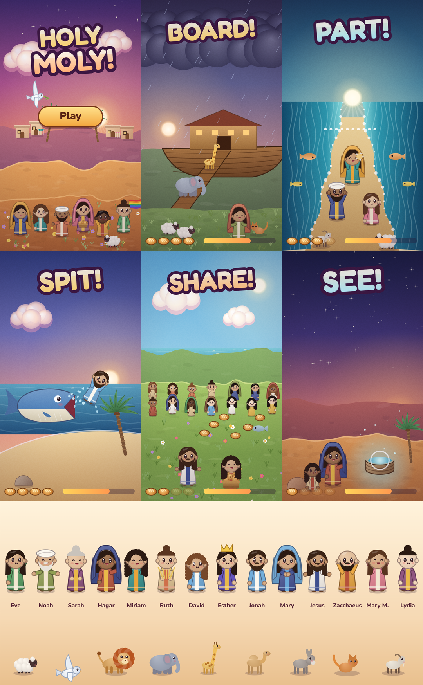

# Holy Moly!

A WarioWare-style Bible microgame collection for kids aged 5 to 11. Each microgame lasts a few seconds, shouts one command ("BOARD!", "PART!", "SHARE!"), and asks for one tap, swipe, drag or hold. The games speed up every few rounds, you have four loaves of bread as lives, and once per run a dove brings you a loaf you didn't earn ("That's grace."). Every microgame you win unlocks a story card with the Bible reference, a two-sentence retelling and a question for families.

The theology follows the mainline churches: the player's verbs are share, welcome, help, rescue, forgive and rest; outsiders (women, foreigners, poor people, children) are the heroes; mercy wins.



## Play
Open `dist/holymoly.html` in a phone or desktop browser. It is one self-contained file that plays offline.

## Build
```
python3 src/build.py dist/holymoly.html
python3 tools/mgtest.py /tmp/hm-mg      # test every microgame and make contact sheets
python3 tools/shots.py /tmp/hm-shots    # screenshot every screen
```
See `CLAUDE.md` for the module map and `docs/MICROGAMES.md` for how to add a microgame.

## Credits
- All art is drawn in code by `src/paint.js`.
- Music: "Lanternbrook" and "Hilltop Dash" from `music-lab/` in this repository.
- Fonts: Fredoka and Nunito (SIL Open Font License; see `src/OFL-*.txt`).
